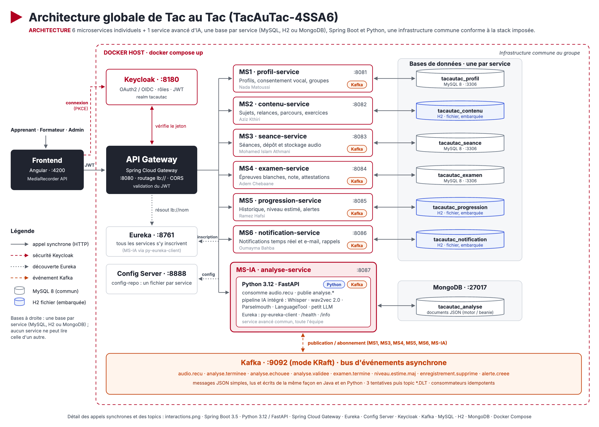
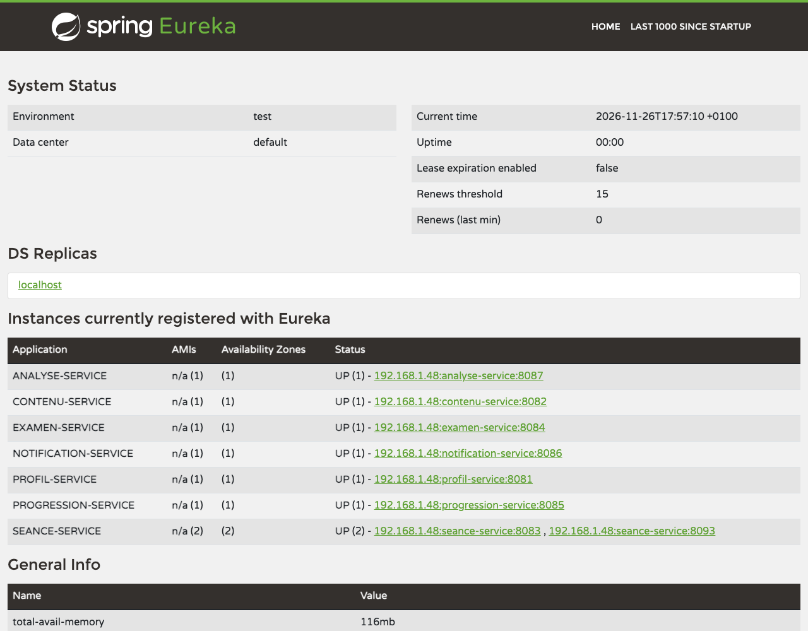

# TacAuTac-4SSA6 : Tac au Tac, plateforme d'entraînement à l'expression orale (FR / EN, CECRL B1 à C2)

Mini-projet du module Applications Web Distribuées (AWD, MT-41), ESPRIT, classe 4SSA6, année 2026-2027.

## Sujet

L'oral est la compétence la plus déterminante aux examens de langue, et la moins entraînée : en classe, chaque apprenant ne parle que quelques minutes, et hors de la classe il n'a presque jamais de retour sur sa prononciation ou sa fluidité.

**Tac au Tac** fait parler l'apprenant depuis son navigateur, analyse chaque prise de parole par intelligence artificielle (transcription, prononciation, fluidité, intonation, lexique, grammaire, cohérence) et le prépare, niveau par niveau, aux certifications orales (DELF, DALF, TCF, Cambridge, IELTS, TOEFL). Le formateur suit ses groupes et garde la décision finale sur les notes.

Acteurs : apprenant, formateur, administrateur d'établissement. L'apprenant est prévenu en temps réel dès que son feedback est prêt et peut programmer des rappels d'entraînement. Les fonctionnalités sont décrites par 17 user stories dans le [dossier technique](Documentation/Dossier_Technique_TacAuTac.docx#25-user-stories).

## Membres

| Membre | Microservice | Port | Base | Fiche de conception |
| --- | --- | --- | --- | --- |
| Nada Matoussi | MS1 `profil-service` | 8081 | MySQL | [Fiche_MS1_profil-service.docx](Documentation/services/Fiche_MS1_profil-service.docx) |
| Aziz Kthiri | MS2 `contenu-service` | 8082 | H2 (fichier) | [Fiche_MS2_contenu-service.docx](Documentation/services/Fiche_MS2_contenu-service.docx) |
| Mohamed Islam Athmani | MS3 `seance-service` | 8083 | MySQL | [Fiche_MS3_seance-service.docx](Documentation/services/Fiche_MS3_seance-service.docx) |
| Adem Chebaane | MS4 `examen-service` | 8084 | MySQL | [Fiche_MS4_examen-service.docx](Documentation/services/Fiche_MS4_examen-service.docx) |
| Ramez Hafsi | MS5 `progression-service` | 8085 | H2 (fichier) | [Fiche_MS5_progression-service.docx](Documentation/services/Fiche_MS5_progression-service.docx) |
| Oumayma Bahba | MS6 `notification-service` | 8086 | H2 (fichier) | [Fiche_MS6_notification-service.docx](Documentation/services/Fiche_MS6_notification-service.docx) |
| Équipe | MS-IA `analyse-service` (microservice avancé commun, en Python / FastAPI) | 8087 | MongoDB | [Fiche_MS-IA_analyse-service.docx](Documentation/services/Fiche_MS-IA_analyse-service.docx) |

## Architecture



| Composant | Technologie | Port |
| --- | --- | --- |
| Frontend | Angular + MediaRecorder API | 4200 |
| API Gateway | Spring Cloud Gateway | 8080 |
| Eureka | Spring Cloud Netflix Eureka Server | 8761 |
| Config Server | Spring Cloud Config, dossier `Backend/config-repo` | 8888 |
| Keycloak | realm `tacautac` | 8180 |
| Kafka | mode KRaft | 9092 |
| MySQL | MS1, MS3, MS4 : un schéma et un utilisateur par service | 3306 |
| H2 (mode fichier) | MS2, MS5, MS6 : base embarquée dans le service, fichiers dans `data/` | |
| MongoDB | base `tacautac_analyse` (MS-IA) | 27017 |
| Docker Compose | lancement global | |

- Interactions (appels synchrones et topics Kafka) : [interactions.png](Documentation/Diagrams/interactions.png)
- Tous les diagrammes : [Documentation/Diagrams](Documentation/Diagrams)
- Dossier technique : [Markdown](Documentation/Dossier_Technique_TacAuTac.md), [Word](Documentation/Dossier_Technique_TacAuTac.docx), [PDF](Documentation/Dossier_Technique_TacAuTac.pdf)

## Structure du dépôt

```
TacAuTac-4SSA6/
├── Backend/                 un projet par microservice : Spring Boot, et Python pour MS-IA
│   ├── profil-service/  contenu-service/  seance-service/  examen-service/
│   ├── progression-service/  notification-service/  analyse-service/
│   └── eureka-server/       annuaire des microservices (port 8761)
├── Frontend/                application Angular
├── Documentation/
│   ├── Presentation/        support de la présentation
│   ├── Diagrams/            diagrammes (PNG) et leurs sources
│   ├── services/            fiches de conception des microservices (Word)
│   ├── captures/            captures d'écran (dashboard Eureka)
│   └── Dossier_Technique_TacAuTac.docx 
└── README.md
```

## Lancement

Prérequis : Java 17 pour les services Spring Boot, MySQL démarré dans XAMPP (port 3306) pour MS1, MS3 et MS4, Python 3.12 pour MS-IA. Les services en H2 (MS2, MS5, MS6) n'ont besoin d'aucune base à installer. Maven n'est pas nécessaire : chaque projet Spring Boot contient son Maven Wrapper (`mvnw`).

```bash
cd Backend/seance-service
./mvnw test                                    # test sur H2, sans MySQL
EUREKA_ENABLED=false ./mvnw spring-boot:run    # démarre le service seul
```

- Swagger de chaque service : `http://localhost:<port>/swagger-ui.html`
- Sous Windows : `mvnw.cmd` au lieu de `./mvnw`.

## Découverte des services avec Eureka

Atelier « Implémentation Eureka server », réalisé par l'équipe : Nada Matoussi, Aziz Kthiri, Mohamed Islam Athmani, Adem Chebaane, Ramez Hafsi et Oumayma Bahba.

- **Serveur** : `Backend/eureka-server` (Spring Boot 3.5.6, Spring Cloud 2025.0.0), annoté `@EnableEurekaServer`, port 8761. Il ne s'inscrit pas chez lui-même (`eureka.client.register-with-eureka=false`, `eureka.client.fetch-registry=false`).
- **Clients** : chaque microservice Spring Boot est annoté `@EnableDiscoveryClient` et a le même bloc dans son `application.properties` (le MS-IA, en Python, s'inscrit avec `py-eureka-client` au démarrage de FastAPI, voir `Backend/analyse-service/app/main.py`) :

```properties
eureka.client.enabled=${EUREKA_ENABLED:true}
eureka.client.register-with-eureka=true
eureka.client.fetch-registry=true
eureka.client.service-url.defaultZone=${EUREKA_URL:http://localhost:8761/eureka}
eureka.instance.prefer-ip-address=true
```



*Dashboard Eureka (http://localhost:8761) : les 7 microservices sont inscrits, et `seance-service` tourne en deux instances (ports 8083 et 8093).*

Pour reproduire, lancer chaque commande dans son propre terminal (MySQL démarré) :

```bash
# 1. Serveur Eureka, puis ouvrir http://localhost:8761
cd Backend/eureka-server && ./mvnw spring-boot:run
# 2. Un microservice (les autres se lancent de la même façon, dans leur dossier)
cd Backend/seance-service && ./mvnw spring-boot:run
# 3. Deuxième instance de seance-service sur le port 8093
cd Backend/seance-service && ./mvnw spring-boot:run -Dspring-boot.run.arguments=--server.port=8093
# 4. Vérification : les ports 8083 et 8093 doivent être UP
curl -s http://localhost:8761/eureka/apps/SEANCE-SERVICE | grep -E "<port|<status>"
```

Une instance apparaît dans le dashboard après 30 à 60 secondes. Sans MySQL, `seance-service` peut tourner sur une base en mémoire : `SPRING_PROFILES_ACTIVE=h2 ./mvnw spring-boot:run`. Le MS-IA se lance avec `uvicorn app.main:app --host 0.0.0.0 --port 8087` (voir `Backend/analyse-service/README.md`).


## Gestion de projet

Tableau GitHub Projects du dépôt (onglet **Projects** TacAuTac)

## Sources de données

Common Voice (CC0), speechocean762 (CC BY 4.0), L2-ARCTIC (CC BY-NC 4.0), Multilingual LibriSpeech (CC BY 4.0), CECRL volume complémentaire 2020 (Conseil de l'Europe), exemples de sujets DELF (format seulement). Aucune voix d'apprenant réel n'est enregistrée. Détails et licences : section 7 du dossier technique.


