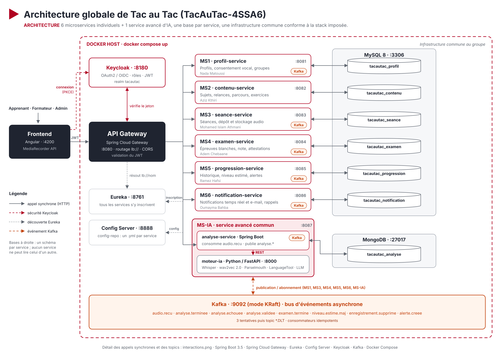

# TacAuTac-4SSA6 : Tac au Tac, plateforme d'entraînement à l'expression orale (FR / EN, CECRL B1 à C2)

Mini-projet du module Applications Web Distribuées (AWD, MT-41), ESPRIT, classe 4SSA6, année 2026-2027.

## Sujet

L'oral est la compétence la plus déterminante aux examens de langue, et la moins entraînée : en classe, chaque apprenant ne parle que quelques minutes, et hors de la classe il n'a presque jamais de retour sur sa prononciation ou sa fluidité.

**Tac au Tac** fait parler l'apprenant depuis son navigateur, analyse chaque prise de parole par intelligence artificielle (transcription, prononciation, fluidité, intonation, lexique, grammaire, cohérence) et le prépare, niveau par niveau, aux certifications orales (DELF, DALF, TCF, Cambridge, IELTS, TOEFL). Le formateur suit ses groupes et garde la décision finale sur les notes.

Acteurs : apprenant, formateur, administrateur d'établissement. L'apprenant est prévenu en temps réel dès que son feedback est prêt et peut programmer des rappels d'entraînement. Les fonctionnalités sont décrites par 17 user stories dans le [dossier technique](Documentation/Dossier_Technique_TacAuTac.docx#25-user-stories).

## Membres

| Membre | Microservice | Port | Base | Fiche de conception |

| Nada Matoussi | MS1 `profil-service` | 8081 | MySQL | [Fiche_MS1_profil-service.docx](Documentation/profil-service/Fiche_MS1_profil-service.docx) |
| Aziz Kthiri | MS2 `contenu-service` | 8082 | MySQL | [Fiche_MS2_contenu-service.docx](Documentation/contenu-service/Fiche_MS2_contenu-service.docx) |
| Mohamed Islam Athmani | MS3 `seance-service` | 8083 | MySQL | [Fiche_MS3_seance-service.docx](Documentation/seance-service/Fiche_MS3_seance-service.docx) |
| Adem Chebaane | MS4 `examen-service` | 8084 | MySQL | [Fiche_MS4_examen-service.docx](Documentation/examen-service/Fiche_MS4_examen-service.docx) |
| Ramez Hafsi | MS5 `progression-service` | 8085 | MySQL | [Fiche_MS5_progression-service.docx](Documentation/progression-service/Fiche_MS5_progression-service.docx) |
| Oumayma Bahba | MS6 `notification-service` | 8086 | MySQL | [Fiche_MS6_notification-service.docx](Documentation/notification-service/Fiche_MS6_notification-service.docx) |
| Équipe | MS-IA `analyse-service` (microservice avancé commun) + `moteur-ia` | 8087, 8000 | MongoDB | [Fiche_MS-IA_analyse-service.docx](Documentation/analyse-service/Fiche_MS-IA_analyse-service.docx) |

## Architecture



| Composant | Technologie | Port |
| --- | --- | --- |
| Frontend | Angular + MediaRecorder API | 4200 |
| API Gateway | Spring Cloud Gateway | 8080 |
| Eureka | Spring Cloud Netflix Eureka Server | 8761 |
| Config Server | Spring Cloud Config, dossier `Backend/config-repo` | 8888 |
| Keycloak | realm `tacautac` | 8180 |
| Kafka | mode KRaft | 9092 |
| MySQL | un schéma et un utilisateur par service (MS1 à MS6) | 3306 |
| MongoDB | base `tacautac_analyse` (MS-IA) | 27017 |
| Docker Compose | lancement global | |

- Interactions (appels synchrones et topics Kafka) : [interactions.png](Documentation/Diagrams/interactions.png)
- Tous les diagrammes : [Documentation/Diagrams](Documentation/Diagrams)
- Dossier technique : [Markdown](Documentation/Dossier_Technique_TacAuTac.md), [Word](Documentation/Dossier_Technique_TacAuTac.docx), [PDF](Documentation/Dossier_Technique_TacAuTac.pdf)

## Structure du dépôt

```
TacAuTac-4SSA6/
├── Backend/                 un projet Spring Boot par microservice (voir Backend/README.md)
│   ├── profil-service/  contenu-service/  seance-service/  examen-service/
│   ├── progression-service/  notification-service/  analyse-service/
├── Frontend/                application Angular
├── Documentation/
│   ├── Presentation/        support de la présentation
│   ├── Diagrams/            diagrammes (PNG) et leurs sources
│   ├── <service>/           fiche de conception du microservice (Word), un dossier par service
│   └── Dossier_Technique_TacAuTac.docx 
└── README.md
```

## Lancement

Prérequis : Java 17 et MySQL démarré dans XAMPP (port 3306). Maven n'est pas nécessaire : chaque projet contient son Maven Wrapper (`mvnw`).

```bash
cd Backend/seance-service
./mvnw test                                    # test sur H2, sans MySQL
EUREKA_ENABLED=false ./mvnw spring-boot:run    # démarre le service seul
```

- Swagger de chaque service : `http://localhost:<port>/swagger-ui.html`
- Sous Windows : `mvnw.cmd` au lieu de `./mvnw`.


## Gestion de projet

Tableau GitHub Projects du dépôt (onglet **Projects** TacAuTac)

## Sources de données

Common Voice (CC0), speechocean762 (CC BY 4.0), L2-ARCTIC (CC BY-NC 4.0), Multilingual LibriSpeech (CC BY 4.0), CECRL volume complémentaire 2020 (Conseil de l'Europe), exemples de sujets DELF (format seulement). Aucune voix d'apprenant réel n'est enregistrée. Détails et licences : section 7 du dossier technique.


